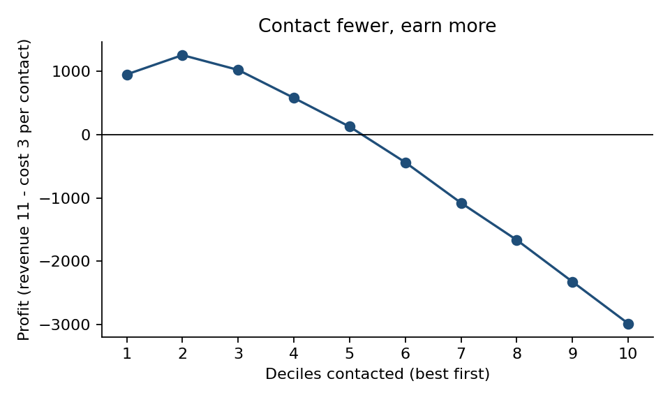
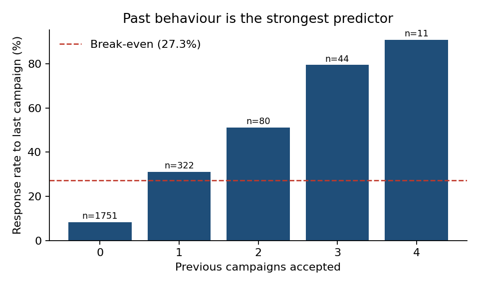
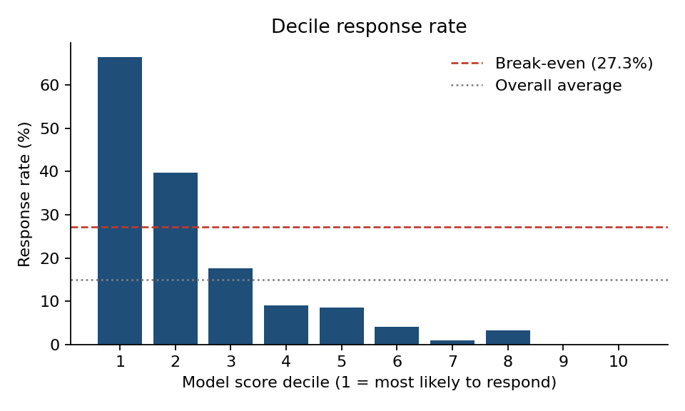

# Campaign Response Targeting: Who Should We Contact?

> One-page version for non-technical readers: [EXECUTIVE_SUMMARY.pdf](EXECUTIVE_SUMMARY.pdf)

**Business question:** A marketing team ran a campaign and got a 15% response rate. Contacting every customer *loses money*. Can past behaviour and customer attributes identify the smaller group worth contacting, and how much better off are we if we target them?

**Answer in one line:** Contacting only the top 20% of customers (ranked by a logistic-regression propensity score) captures **71% of all responders** and turns a **-2,983 loss into a +1,259 profit**.

| Strategy | Contacts | Responders | Profit* |
|---|---|---|---|
| Contact everyone | 2,208 | 331 | **-2,983** |
| Top 10% by model score | 221 | 147 | +954 |
| **Top 20% by model score** | **442** | **235** | **+1,259** |
| Top 50% by model score | 1,105 | 313 | +128 |

\*Profit = 11 per responder - 3 per contact (see [Assumptions](#assumptions-and-limitations)). Break-even response rate = 3 / 11 = 27.3%.



## Tools used

| Tool | Where | What for |
|---|---|---|
| **Python** (pandas, scipy, scikit-learn, matplotlib) | `src/` | Cleaning, feature engineering, statistical tests, propensity model, charts |
| **SQL** (SQLite) | `sql/` | Segment analysis, decile lift table (`NTILE`, window functions), profit-by-depth |
| **Statistics** | `src/02_statistics.py` | Chi-square, Mann-Whitney, Cramer's V, Bonferroni correction, bootstrap CI |

## Project structure

```
data/raw/marketing_campaign.csv      original file (semicolon-separated, 2,240 rows)
data/processed/customers_clean.csv   cleaned + engineered features
EXECUTIVE_SUMMARY.pdf                 one-page summary (PDF) for non-technical readers
sql/01_segment_response.sql          response rate by segment
sql/02_decile_lift.sql               decile lift + cumulative gains
sql/03_roi_by_depth.sql              profit if we contact the top N deciles
src/01_clean_load.py                 clean data, load into SQLite
src/02_statistics.py                 hypothesis tests
src/03_model_targeting.py            model, scoring, lift, ROI, charts
outputs/                             test results, odds ratios, charts
```

## How to run

```bash
pip install -r requirements.txt
./run_all.sh        # or run the three scripts in src/ in order
```
Requires Python 3.9+ and SQLite 3.25+ (window functions). Output: `data/campaign.db`, and charts and tables in `outputs/`.

## 1. Data cleaning (Python)

2,240 rows -> **2,208** after dropping 32 rows:

- 24 rows with missing `Income`
- 1 income outlier (666,666, about 10x the next-highest value in that range)
- 3 impossible birth years (1893, 1899, 1900)
- 4 rows with junk marital status values ("Absurd", "YOLO"); "Alone" merged into "Single"

Two judgement calls worth knowing about: 182 rows are identical on every attribute except `ID`. They were **kept**, because there is no way to tell duplicates from similar customers. `Z_CostContact` and `Z_Revenue` are constant columns, so they were not used as features; they are used as the cost/revenue assumption in the profit analysis.

Engineered features: age, total spend, wine share of spend, total purchases, deal-purchase share, children at home, tenure (days), number of previous campaigns accepted.

## 2. What drives response (SQL + statistics)



- **Past behaviour dominates.** Customers who accepted at least one earlier campaign respond at **40.7%** vs **8.3%** for those who never did (gap 32.4 pp, 95% bootstrap CI 27.8 to 37.1 pp). Response climbs from 8% (0 prior) to 31%, 51%, 80%, and 91% (4 prior).
- **Recency matters.** Customers who purchased in the last 20 days respond at 28.7%; those inactive 81+ days at 6.3%.
- **Households with children respond far less** (26.5% with none vs about 10% with one or more).
- **Statistically significant after Bonferroni correction (12 tests):** prior acceptance, education, marital status, children, income, spend, recency, tenure, deal share. **Not significant:** age, web visits per month, complaints.
- **Income is partly a proxy for spend.** Raw response rises with income (10% in the lowest quartile, 27% in the highest), but inside the mid-spend tier, above-median-income customers respond *less* (8.4% vs 16.1%, n = 356 and 380). Some other cells are too small (n < 30) to read. Do not target on income alone.

Full test table: `outputs/statistical_tests.csv`.

## 3. Propensity model and targeting (Python + SQL)

Logistic regression on 14 features, scored with **5-fold out-of-fold predictions**, so every customer's score comes from a model that never saw them.

| Model | Out-of-fold AUC |
|---|---|
| Rank by "previous campaigns accepted" only | 0.771 |
| Gradient boosting (depth 2, 150 trees, untuned) | 0.883 |
| **Logistic regression (used)** | **0.893** |

Logistic regression was chosen because it is at least as accurate here and every coefficient (`outputs/model_odds_ratios.csv`) can be explained to a business stakeholder.



| Decile | Response rate | Lift | Cumulative % of responders |
|---|---|---|---|
| 1 | 66.5% | 4.4x | 44% |
| 2 | 39.8% | 2.7x | 71% |
| 3 | 17.6% | 1.2x | 83% |
| 4-10 | under 10% | under 0.6x | 100% |

Only deciles 1 and 2 beat the 27.3% break-even rate, which is why profit peaks at two deciles. Deciles 9 and 10 contain **zero** responders out of 440 customers.

## Assumptions and limitations

1. **This is a response model, not an incrementality model.** There is no holdout/control group, so the data cannot show who responded *because of* the campaign versus who would have bought anyway. The top deciles are probably full of customers who were going to buy regardless. The profit figures are "profit from responders", not "profit caused by the campaign". Proving the latter needs a randomized control group.
2. **Cost 3 / revenue 11 are assumptions.** They come from two constant columns whose meaning is not documented. If the real ratio differs, the optimal contact depth changes (a lower break-even rate means contacting deeper).
3. **One campaign, 331 responders.** Decile-level counts are small, and the profit curve is noisy beyond decile 3. The 71% capture rate would need to be confirmed on a new campaign.
4. **Odds ratios are not clean causal effects.** Spend, purchases, and wine share are correlated, and education/marital coefficients are relative to the baseline categories (2n Cycle, Divorced). PhD (odds ratio 5.3) rests on 478 customers.
5. **Old, possibly synthetic data.** Signups run from 2012 to 2014, and the file looks like a public teaching dataset. Treat the findings as a worked method, not as business conclusions.

## Possible next steps

- Hold out a final 20% test set and tune the model on the rest
- Calibrate probabilities and choose the contact cutoff from expected value per customer instead of fixed deciles
- Add an uplift or control-group design if experiment data becomes available
